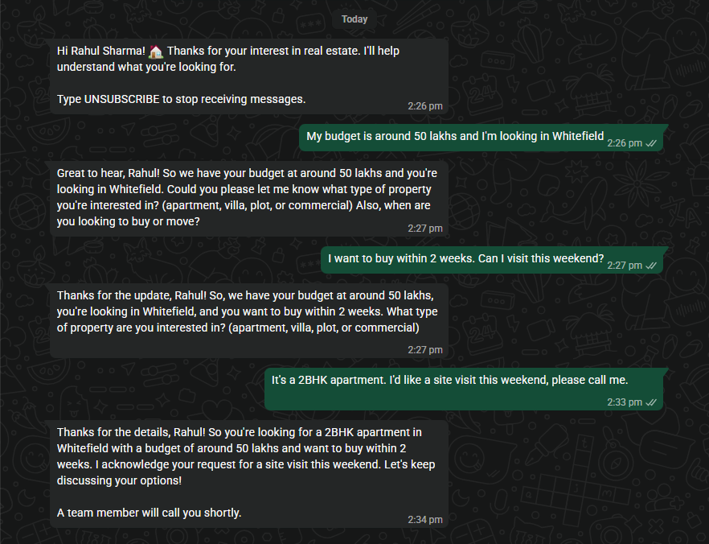
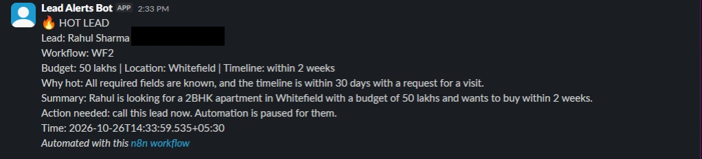
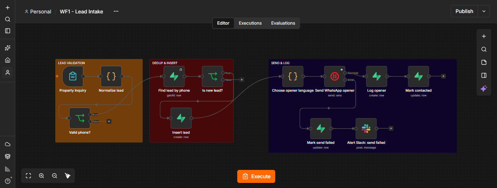
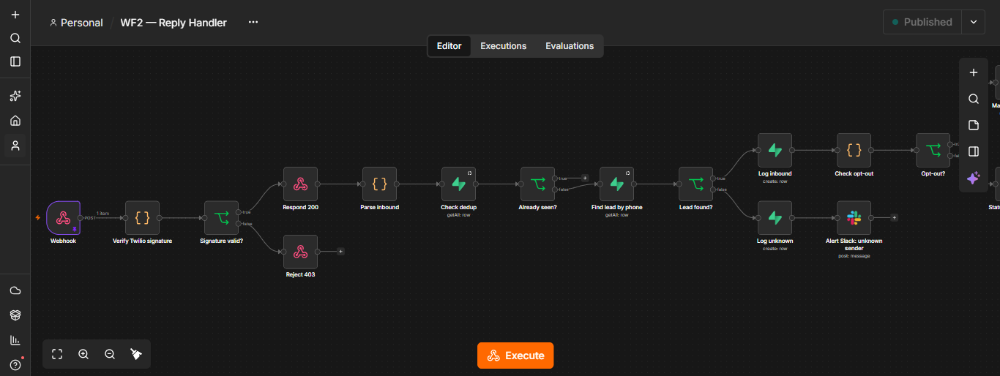
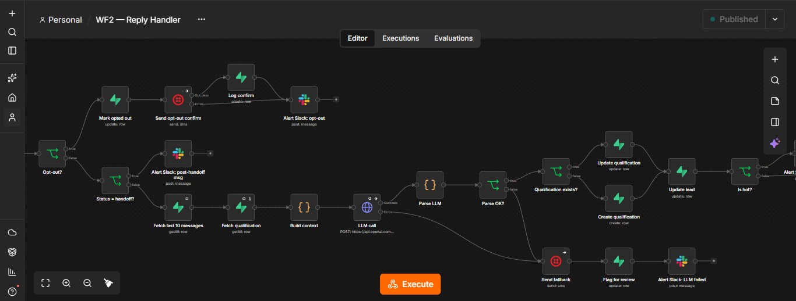
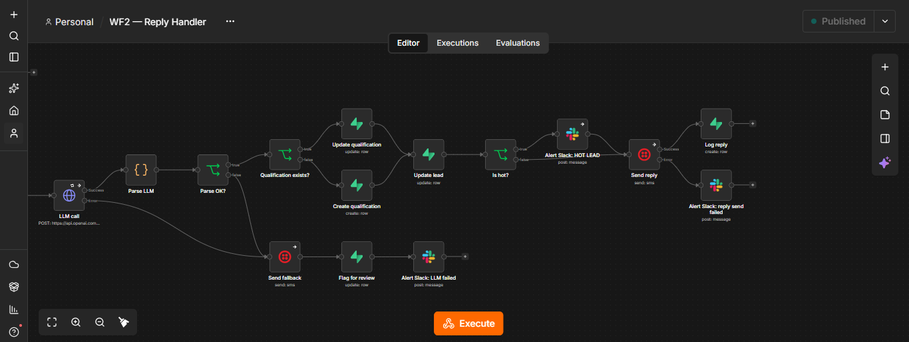
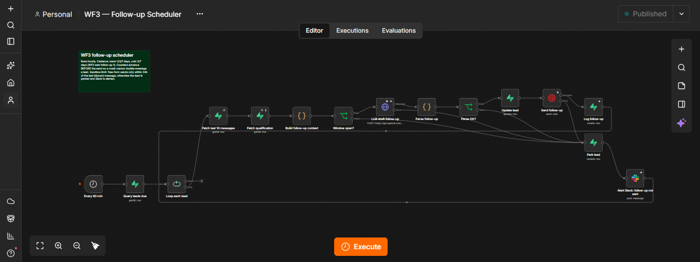
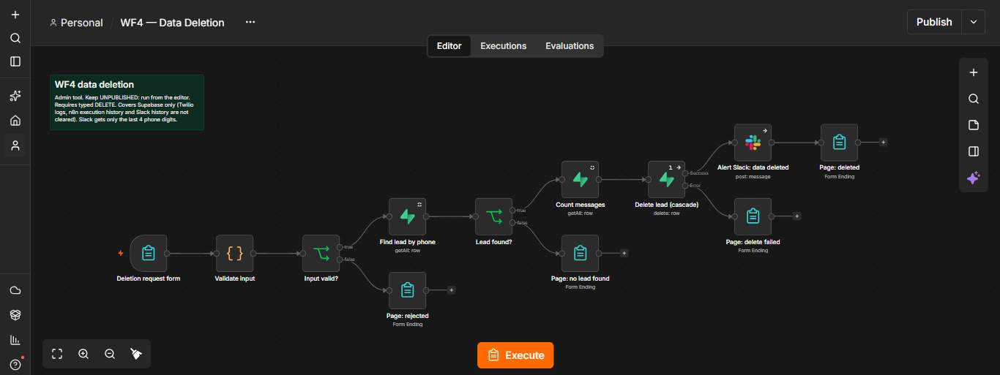

# WhatsApp Lead Follow-up (n8n hardened prototype)

Greets a new real-estate lead on WhatsApp, qualifies them in Hindi or English, alerts a human the moment a lead is ready to buy, and nudges leads who go quiet.

> **Status: hardened prototype, not production.** It handles the happy path, common failures, duplicate events, opt-outs and a delete-my-data request, and it logs and alerts on failure. It has no multi-tenancy, no rate limiting, no monitoring beyond Slack, and no compliance review. It runs on the Twilio WhatsApp **sandbox**, not the WhatsApp Business API.

## What it does

| Workflow | Trigger | Job |
|---|---|---|
| **WF1 Lead Intake** | Form submission | Validates phone and consent, stores the lead, sends a WhatsApp opener (Hindi, English or both). |
| **WF2 Reply Handler** | Twilio webhook | Verifies the signature, drops duplicates, handles opt-outs, asks an LLM for the next reply and a qualification, lets *code* decide the score and the handoff, sends the reply. Hot leads alert Slack. |
| **WF3 Follow-up Scheduler** | Every 60 min | Finds leads due a nudge, checks the 24 h window, drafts a short follow-up with the LLM, sends it, advances the cadence. Failures park the lead and alert Slack. |
| **WF4 Data Deletion** | Form (admin, run from the editor) | Deletes one lead by phone, with messages and qualification removed by cascade, after a typed `DELETE` confirmation. Slack gets a masked alert. |

## Demo screenshots

One test run on the Twilio sandbox, with a fake lead name ("Rahul Sharma") and the author's own phone. The lead gives budget and location, then a timeline, then the property type and a site-visit request. Code confirms the lead is hot and sends the call confirmation.

**WhatsApp thread**



**Slack hot-lead alert**



The alert includes the lead's full phone number so a human can call. It is covered in this screenshot.

## Workflow canvases

### WF1 — Lead Intake



### WF2 — Reply Handler (39 nodes)

The reply handler is shown in three parts, left to right.







### WF3 — Follow-up Scheduler



### WF4 — Data Deletion



> **Note:** n8n labels the Twilio send operation "sms" in the canvas. WhatsApp mode is on — the nodes send to WhatsApp, not SMS.

## Architecture

```
                       +------------------+
 Lead form ----------> |  WF1 Lead Intake | --- opener ---> Twilio WhatsApp ---> lead's phone
                       +--------+---------+
                                |  insert
                                v
                       +------------------+        +-----------------------------+
                       |  Supabase (PG)   | <----> |  WF3 Follow-up Scheduler    |
                       |  leads           |        |  hourly; 24 h window check; |
                       |  messages        |        |  LLM nudge; park + alert    |
                       |  qualifications  |        +--------------+--------------+
                       +--------+---------+                       |
                                ^                                 v
 lead's reply --> Twilio -->    |                          Twilio WhatsApp
   webhook      +---------------+---+
                |  WF2 Reply Handler |--> OpenAI (gpt-4o-mini, JSON out) --> validate in code
                |  signature check   |--> Slack #lead-alerts (hot lead, errors, opt-outs)
                |  dedup, opt-out    |
                +--------------------+

 Admin form --> WF4 Data Deletion --> Supabase delete (cascade) --> Slack (masked alert)
```

## Design decisions

- **Code decides, the model proposes.** The LLM drafts the reply and suggests a score. Code validates the JSON, re-checks the "hot" criteria (all of budget, location, timeline, an explicit visit request, and a timeline within 30 days where it can be parsed), sets `handoff`, and appends any call confirmation. A model cannot promote a lead to hot or promise a call on its own.
- **Validate before acting.** Raw model output never triggers a send or a database write. Bad JSON, a missing field or a value outside the allowed set goes to a fallback path, not to the lead.
- **Reserve, then send (at most once).** WF3 advances `followup_count` and `next_follow_up_at` *before* it sends. A crash between the two cannot double-message a lead. The cost is that a failed send still consumes one follow-up.
- **Park and alert instead of retrying forever.** A follow-up that cannot be sent clears `next_follow_up_at`, records the reason in `send_error`, and posts to Slack. A human decides what happens next.
- **Idempotency on inbound.** WF2 looks up Twilio's `MessageSid` (stored as `messages.external_id`, which is `UNIQUE`) before doing any work.
- **Signature check first.** WF2 verifies `X-Twilio-Signature` and answers `403` to anything else.
- **Language is chosen by code.** From the lead's latest message and up to two earlier ones: Devanagari means Hindi, three or more English words mean English, and a short Latin-only message ("ok", "Hello") counts as English unless a recent message is Devanagari. The stored preference is used only when none of them contains letters (for example emoji). The prompt is told which language to write in.
- **Deletion tool leaks as little as possible.** The WF4 Slack alert carries the last 4 phone digits and no name, because an alert that repeats the data defeats the deletion.
- **Provider-specific code kept at the edges.** Scoring rules, cadence and prompts live in Code nodes and the schema, not in provider calls. Twilio-specific code is confined to a few nodes: the signature check, inbound parsing (Twilio field names), the send nodes and WF3's 24 h window rule. OpenAI and Slack are single nodes. Swapping a provider should mean replacing those nodes; this has not been tried.

## What's real vs simulated

**Real**
- n8n Cloud workflows, run on a schedule and on live webhooks.
- Supabase Postgres storing leads, messages and qualifications.
- OpenAI `gpt-4o-mini` calls with JSON output.
- WhatsApp messages sent through the Twilio **sandbox** to the author's own phone.
- Slack alerts posted to a real channel.

**Simulated or limited**
- All leads are test data: the author's number, plus fake numbers inserted for tests.
- The WhatsApp channel is the Twilio sandbox. Recipients must join the sandbox first. Free-form messages are only allowed within 24 hours of the lead's last message, and there are no approved templates.
- Bad-JSON handling in WF3 was tested with **pinned, simulated** model output (three cases), because the real model would not produce bad JSON on request.
- No load testing. No real leads. No delivery confirmation beyond Twilio's "queued".

## Testing evidence

What was run, from n8n execution history:

| Area | What was checked | Result |
|---|---|---|
| WF3 | Five due leads in one real run: last follow-up sent, Twilio failure, OpenAI failure, no-messages lead, outside-window lead. Five decoys (opted out, handoff, closed, error, count 3) | Correct outcome for each. Decoys untouched. |
| WF3 | Not-JSON, unsupported language code, over-long reply (pinned simulated output) | All routed to park, no update, no send |
| WF3 | Hourly schedule | 12 consecutive automatic runs, one hour apart (18:30 UTC on 22 Oct to 05:30 UTC on 23 Oct), all successful |
| WF2 | Language rule: 11 message-window cases run offline against the node's logic (Hindi, English, short "ok", emoji only), plus a live "Hello" from a Hindi-preference lead | All passed; the live reply came back in English |
| WF2 | A reply resets `followup_count`, clears `send_error`, reschedules | Verified on live executions |
| WF4 | Bad phone, wrong confirmation, unknown phone | Rejected or "no lead found"; nothing deleted |
| WF4 | Real delete from the browser form | Lead, messages and qualification gone; Slack alert posted; "Deleted" page shown |

**Not tested:** WF4's "delete failed" path; two inbound messages racing a WF3 run on the same lead; a real model producing bad JSON unprompted.

## Known limitations

1. **Sandbox only.** Not the WhatsApp Business API; no approved templates.
2. **Cadence follow-ups usually park.** Follow-ups fall due 1 or 3 days after the lead's last message, which is outside the 24 h window, so on the sandbox they are parked and alerted rather than sent. A real send only happens inside the window, in manual or demo setups. A production version needs approved templates.
3. **Delivery is only "queued".** There is no status callback, so a message can be accepted by Twilio and never delivered without the system knowing.
4. **A failed send still consumes a follow-up** (the price of at-most-once sending).
5. **Hinglish counts as English.** Hindi typed in Latin letters is treated as English by the language rule.
6. **Timeline parsing is keyword-based.** It understands phrases like "2 weeks" or "3 months" in English and Hindi, and cannot parse the rest. An unparseable timeline is not downgraded by the 30-day check.
7. **Opt-out is a fuzzy contains-match.** Words such as STOP or CANCEL inside a normal sentence can trigger it.
8. **Race risk.** WF2 and WF3 can update the same lead at nearly the same moment. Nothing locks the row.
9. **Error text from n8n is generic.** The Twilio and OpenAI nodes surface n8n's wrapper message ("Bad request - please check your parameters"), not the provider's real reason.
10. **One message went missing once**, minutes after a workflow was published (a reply produced no execution). Cause not established. Avoid publishing changes right before a demo.
11. **Deletion covers Supabase only.** Twilio logs, n8n execution history and Slack history are not cleared. WF4's own execution log keeps the deleted lead's data. WF4 also cannot remove messages from unknown senders: WF2 stores those with `lead_id` NULL and no phone number, so there is nothing to match on. Delete them by hand in Supabase.
12. **WF1 drops silently.** A form with an invalid phone or no consent, and a phone that already exists, produce no response or alert.
13. **Schema gaps.** `leads` has no `updated_at`; `qualifications` has no `created_at`; `messages` carries a redundant index.
14. **Single tenant, India-only.** Phone normalisation assumes `+91` and ten digits. No rate limiting, no monitoring beyond Slack.
15. **WF2 "LLM failed" alert has no error reason**, and outbound WF2 messages do not store Twilio's SID.
16. **The form's language choice is a weak signal.** Replies follow what the lead writes, not what they picked on the form. A Hindi-preferring lead who sends only short Latin-letter messages such as "ok" or "haan" gets English until they write something in Devanagari. This was found in a live run (a short "Hello" got Hindi) and the rule was changed to treat short Latin-only messages as English.

## How this was built

I built this with Claude (Anthropic's AI) as a pair programmer. That's why the commits carry its co-author tag. Here's the split, as plainly as I can put it.

**What I did.** I decided how the system should behave and how it should fail: when a lead counts as hot, the follow-up schedule, when a human takes over, what goes to Slack, what the sandbox can't do. Claude proposed options and I chose. I set up the accounts, ran every workflow myself (forms, WhatsApp messages from my own phone), checked the n8n executions and the database afterwards, and decided what to change when something looked wrong.

**What Claude did.** It wrote most of the workflow code and the SQL.

**Things I ran into while testing.** A short "Hello" got a Hindi reply, so I changed the language rule (limitation 16). After I rotated the Twilio auth token, WF2 rejected incoming messages until I recreated the n8n variable, and the messages sent in that gap got no reply.

I'm self-taught, and I can explain how each part works and why it's there.

## Setup

1. Create a Supabase project and run `sql/schema.sql` in the SQL Editor. Review it first: it was reconstructed from a live database and was not run as one script on a fresh one.
2. In n8n, create the credentials listed in `.env.example` (Supabase service-role key, Twilio, OpenAI, Slack).
3. Create an n8n **variable** named `TWILIO_AUTH_TOKEN`. WF2 reads it as `$vars.TWILIO_AUTH_TOKEN` to verify signatures.
4. Import the files in `workflows/`. In each node that shows `REPLACE_WITH_YOUR_CREDENTIAL_ID`, select your own credential.
5. Point the Twilio sandbox inbound-message webhook URL at WF2's **production** webhook URL (`.../webhook/twilio-inbound`), and publish WF2.
6. Edit the Slack channel in the Slack nodes. Two nodes (one in WF1, one in WF2) use the placeholder channel ID `YOUR_SLACK_CHANNEL_ID`; the rest select the channel by name, `#lead-alerts`. Point all of them at your own channel.
7. Publish WF3 for the hourly schedule. Leave WF4 unpublished and run it from the editor.
8. WF1's form was also used from the editor during testing. Publish WF1 if you want a permanent form URL (not verified here).

The workflows were built on n8n Cloud. Node versions are as exported; on another n8n version, expect to re-check node parameters.

## Repository layout

```
workflows/   exported n8n workflows (credentials removed)
sql/         schema.sql
examples/    sample payloads (minimal, not full Twilio captures)
docs/images/ workflow canvas screenshots
.env.example credentials to create in n8n (names only)
LICENSE      MIT
```

## License

MIT. See [LICENSE](LICENSE).
